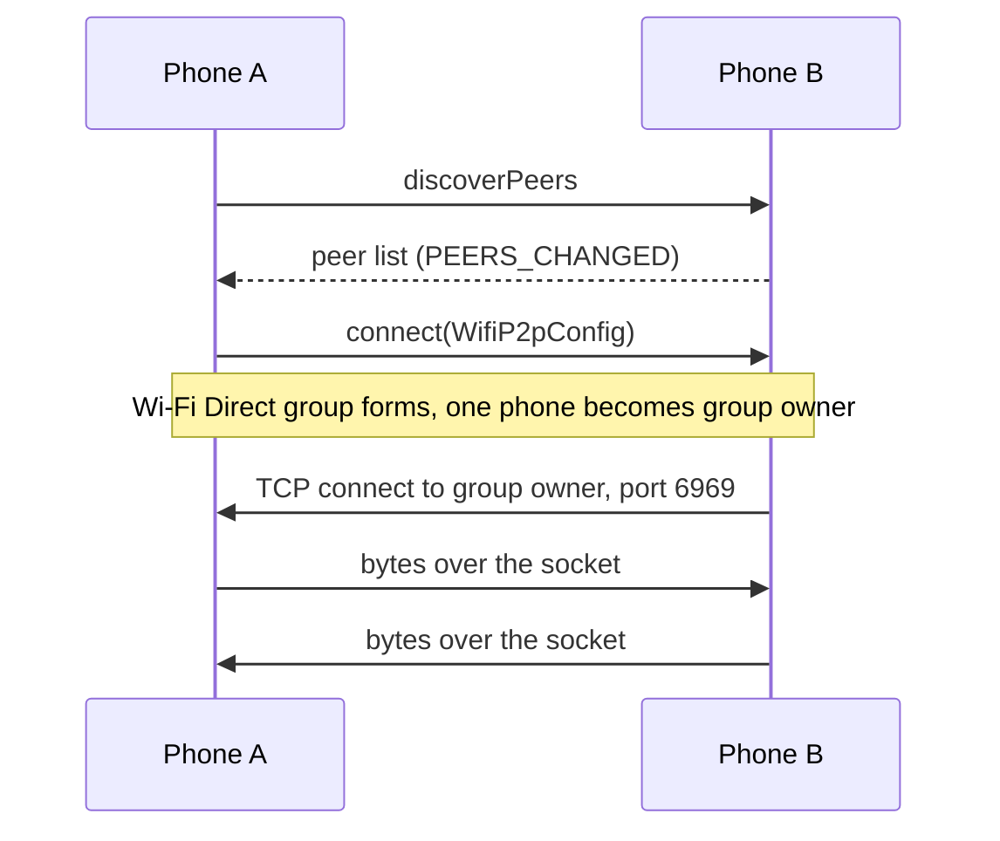

# WiFind

Phone to phone messaging over Wi-Fi Direct, with no internet, no router and no cell signal.

## The problem

Messaging apps stop working exactly where you can't call for help either: tunnels, ships, planes, mines. Two Android phones a few dozen meters apart can still talk to each other directly over Wi-Fi. This project is the core of that idea.

## What I built

This repo is the networking prototype (app label `p2p-1.0.1`): one screen that discovers nearby devices, connects to one and opens a socket between the two.

- Discover peers and list them
- Tap a peer to connect
- Send text one way or the other and show what arrives

It is a link-layer demo. In this version the Send button transmits a fixed test string, and there are no profiles or chat history yet.

## Architecture

| Class | Job |
|---|---|
| `MainActivity` | UI, peer list, and the `ServerClass`, `ClientClass` and `SendReceive` threads |
| `WiFiDirectBroadcastReceiver` | Reacts to the four Wi-Fi P2P system broadcasts |

## Design decisions

- Roles come from the Wi-Fi Direct group. Whichever phone Android makes group owner opens a `ServerSocket`, the other connects to the owner's address. Neither user has to pick "host" or "join".
- Plain TCP on top of the group. Wi-Fi Direct gives an IP link and nothing more, so a socket is the simplest thing that carries bytes both ways.
- Network I/O stays off the main thread. A reader thread blocks on the input stream and hands each message to the UI through a `Handler`.
- The broadcast receiver is registered in `onResume` and unregistered in `onPause`, so the app stops reacting to P2P events when it isn't on screen.

## Building

This is an old project: Android Gradle Plugin 3.3.2, Gradle 4.10.1, target SDK 28, pre-AndroidX support libraries. The simplest route is to open it in Android Studio and accept the upgrade assistant.

To run on current Android it also needs:

- `ACCESS_FINE_LOCATION` requested at runtime (Android 10 and up), and `NEARBY_WIFI_DEVICES` on Android 13 and up
- `android:exported="true"` on the launcher activity

Firebase is declared in Gradle but not used by the code. Remove the `google-services` plugin, or add your own `google-services.json`.

Wi-Fi Direct does not work in the emulator. You need two physical phones.
